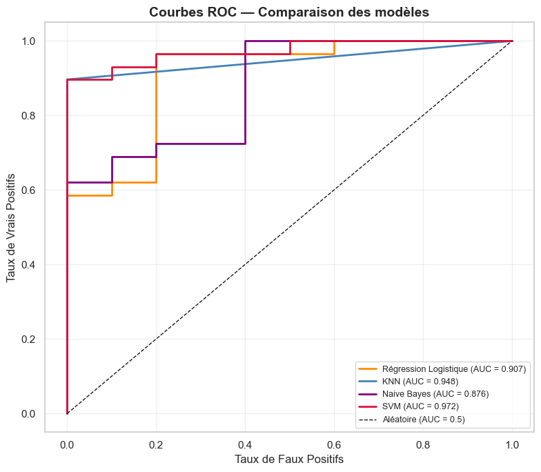
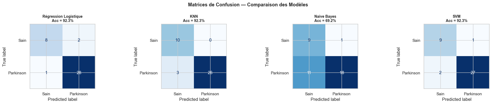

# Parkinson's Detection from Voice Measurements

A statistical learning team project: classifying people with Parkinson's disease from 22 voice measurements, comparing four models, and testing how well the results hold up on patients the models have never seen.

**Team:** Tasnim Boumaiza, Sanou Samiratou Nandia Grace, Youssef Dridi, Wissem Bahrouni, Ayoub Amiria

**Notebook (French):** [`Parkinson_Modelisation_Final.ipynb`](Parkinson_Modelisation_Final.ipynb) · **Report (French):** [`rapport_parkinson.pdf`](rapport_parkinson.pdf)

> This is an educational project, not a diagnostic tool.

## Key finding

The models reach about 92% accuracy on a random split, but that split places recordings of the same patient in both training and test sets. When each patient is kept on one side only, accuracy falls to 79% at best, close to the 75% achieved by always predicting Parkinson's.

## Data

The [Oxford Parkinson's Disease Detection Dataset](https://doi.org/10.24432/C59C74) has 195 voice recordings, with 147 from people with Parkinson's and 48 from healthy people. Each row holds 22 measurements of frequency, jitter, shimmer, noise and signal complexity.

The file names identify 32 patients, 24 with Parkinson's and 8 healthy, with 6 or 7 recordings each. The dataset's documentation and the report say 31.

## Approach

1. **Exploration:** Welch's t-tests and correlation analysis, which show strong differences for `PPE` and `spread1` and high redundancy among jitter and shimmer measures.
2. **Feature engineering:** added frequency range and ratio, and reduced the 11 jitter and shimmer measures to 2 PCA components, leaving 15 features.
3. **Modeling:** L1 logistic regression, KNN, Gaussian Naive Bayes and an RBF SVM, on a stratified 80/20 split.
4. **Patient-level check:** [`patient_level_validation.py`](patient_level_validation.py) repeats the evaluation with each patient kept in a single fold.

The report also describes a wider process than the final notebook, including six engineered features, Mann-Whitney tests and `GridSearchCV`. The notebook holds the final hyperparameters.

## Results

### Random split, as in the notebook

Scores on 39 test recordings. All 24 patients in this test set also have recordings in the training set.

| Model | Accuracy | Precision | Recall | F1 | ROC-AUC |
| --- | --- | --- | --- | --- | --- |
| Logistic Regression | 0.923 | 0.933 | 0.966 | 0.949 | 0.907 |
| KNN | 0.923 | 1.000 | 0.897 | 0.945 | 0.948 |
| Naive Bayes | 0.692 | 0.947 | 0.621 | 0.750 | 0.876 |
| SVM | 0.923 | 0.964 | 0.931 | 0.947 | 0.972 |





### Record-level vs patient-level validation

5-fold cross-validation repeated 20 times, averaged. Recall and specificity are for the patient-level split.

| Model | AUC, record-level | AUC, patient-level | Accuracy, record-level | Accuracy, patient-level | Recall | Specificity |
| --- | --- | --- | --- | --- | --- | --- |
| Logistic Regression | 0.887 | **0.746** | 0.848 | **0.788** | 0.883 | 0.498 |
| Naive Bayes | 0.860 | **0.751** | 0.776 | **0.714** | 0.745 | 0.619 |
| SVM | 0.956 | **0.643** | 0.921 | **0.756** | 0.889 | 0.347 |
| KNN | 0.928 | **0.640** | 0.939 | **0.753** | 0.862 | 0.418 |
| Always predict Parkinson's | 0.500 | 0.500 | 0.754 | 0.754 | 1.000 | 0.000 |

- **Same-patient recordings inflate scores:** SVM AUC falls from 0.96 to 0.64, and KNN from 0.93 to 0.64. With K=1, KNN can often find another recording from the same patient.
- **Simpler models hold up better:** logistic regression and Naive Bayes keep the highest patient-level AUC, at about 0.75.
- **Healthy people are hard to identify:** on unseen patients, the best specificity is 0.62, so many healthy people are flagged as having Parkinson's.

## Limitations

- **Few patients:** with only 8 healthy patients, patient-level scores depend heavily on who lands in each fold.
- **Hyperparameters not retuned:** the patient-level check reuses the notebook's settings, which may favor same-patient matches. Tuning with patient-level folds could improve the scores somewhat.
- **Single dataset:** the models haven't been tested on an independent group of patients.

## Run it

```bash
git clone https://github.com/wissou11/parkinson-voice-detection.git
cd parkinson-voice-detection
python -m venv .venv
source .venv/bin/activate   # Windows: .venv\Scripts\activate
pip install -r requirements.txt
jupyter notebook Parkinson_Modelisation_Final.ipynb
python patient_level_validation.py
```

Tested with Python 3.12.

## Data citation

The dataset is available under [CC BY 4.0](https://creativecommons.org/licenses/by/4.0/).

- Little, M. (2007). *Parkinsons* [Dataset]. UCI Machine Learning Repository. https://doi.org/10.24432/C59C74
- Little MA, McSharry PE, Roberts SJ, Costello DAE, Moroz IM. *Exploiting Nonlinear Recurrence and Fractal Scaling Properties for Voice Disorder Detection.* BioMedical Engineering OnLine 2007, 6:23.

## Tech stack

Python, pandas, NumPy, SciPy, scikit-learn, Matplotlib, seaborn
